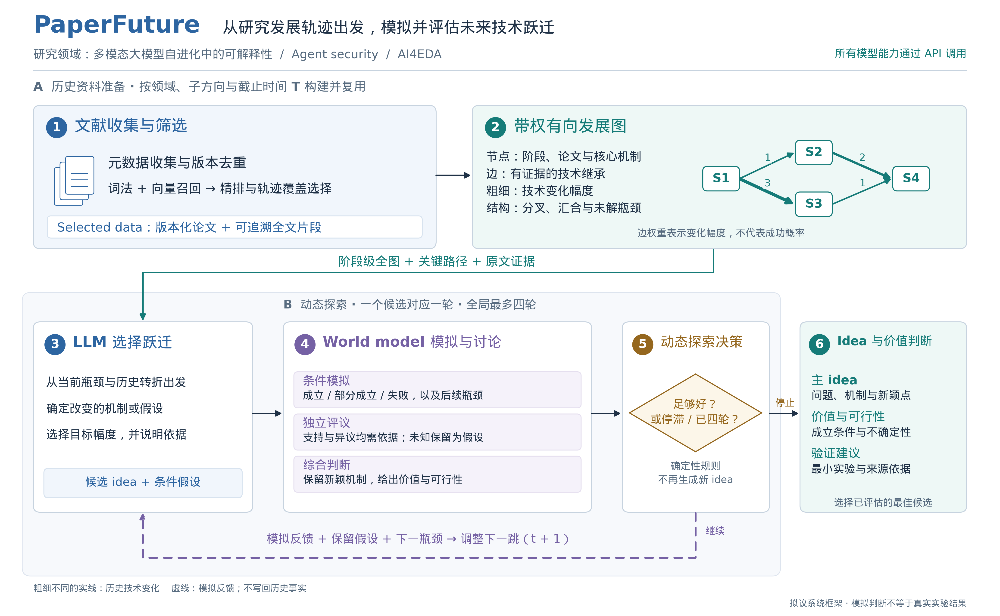

# PaperFuture 系统模块与代码设计

日期：2026 年 10 月 12 日。本设计细化 [研究设计与评测方案](PAPERFUTURE_RESEARCH_DESIGN_2026-10-12.zh-CN.md) 中的六个环节，面向多模态大模型自进化中的可解释性、Agent security 和 AI4EDA 设计。三个领域共用流程与接口，以领域配置区分资料范围、术语和评价条件。所有模型推理通过 API 完成。

系统要把文献中的发展轨迹转化为能够指导下一步技术变化的依据：图描述过去发生了什么，LLM 提出接下来改变什么，world model 推演这种变化可能带来的结果与新瓶颈，再决定是否继续。下面的类名、字段、接口和参数是建议实现的约定，代码块中标为草案的接口尚未接入当前生产流程；框架图表达目标设计，不代表实验效果已经成立。

## 一 系统框架与模块边界



图中上层按领域、子方向和截止时间准备历史资料，可以被多个运行复用。下层是一次预测任务的动态探索：一个候选或实质修订占一轮，全部候选共用最多四轮。紫色虚线将模拟反馈送回跃迁环节，其中的预测始终保留条件假设；历史发展图在一次运行中只读。

图的 [英文 PDF](../figures/paperfuture_framework_en.pdf) 可用于论文，[英文 SVG](../figures/paperfuture_framework_en.svg) 和 [中文 SVG](../figures/paperfuture_framework_zh.svg) 可继续编辑；[绘图脚本](../figures/draw_paperfuture_framework.py) 可重新生成全部版本，[LaTeX 图注](../figures/paperfuture_figure.tex) 与图中语义一致。

| 环节 | 输入 | 输出 | 主要代码落点 |
|---|---|---|---|
| 1 文献收集与筛选 | 领域、具体问题、截止时间、历史资料源 | `SelectedCorpus`：论文版本、全文证据、选择理由与覆盖缺口 | `scripts/literature/`、`services/localindex.py`、`services/sources.py` |
| 2 带权有向发展图 | selected data 中的论文贡献与证据 | `TrajectoryGraph`：阶段节点、演化边、跃迁幅度及依据 | `extras/researchspace.py`，复用现有构图与时间切片代码 |
| 3 LLM 选择跃迁 | 阶段级全图、关键路径、详细证据、前轮反馈 | `LeapProposal`：出发点、技术变化、目标幅度、候选 idea | `extras/openworld/remote.py`、`ideation.py` |
| 4 world model 模拟与讨论 | 候选、原文证据、目标条件、继承的假设 | `RoundAssessment`：条件预测、异议、价值、可行性和下一瓶颈 | `ideation.py`、`discovery.py` |
| 5 动态探索 | 本轮评价、已完成轮次、此前最佳候选 | `RoundDecision`：停止、修订或继续跃迁 | `discovery.py` 的确定性决策逻辑 |
| 6 idea 与价值判断 | 全部已完成并评估的候选 | `FinalIdea`：主 idea、价值、可行性、验证建议与不确定性 | `ideation.py` 的输出与渲染函数 |

存储、API 客户端、缓存、版本校验和成本记录是这些环节共用的工程能力。首版复用现有模块与普通文件，不引入新的研究模块、图神经网络或自训练控制器。

## 二 一次任务的数据约定

### 任务与运行标识

`RunSpec` 至少包含以下字段。

```python
# 数据接口草案；日期使用带时区的 UTC datetime。
from __future__ import annotations
from dataclasses import dataclass
from datetime import datetime
from typing import Literal

@dataclass(frozen=True)
class RunSpec:
    run_id: str
    replicate_id: str
    domain: str
    subfield: str
    question: str
    cutoff: datetime
    snapshot_id: str
    mode: Literal["retrospective", "prospective"]
    max_rounds: int = 4
```

`domain` 使用三个受控取值，如 `multimodal_self_evolution_xai`、`agent_security`、`ai4eda`；`subfield` 是实际建图的研究线。例如 Agent security 中的“工具返回内容引发的间接提示注入”比整个“大模型安全”更适合作为一个发展图的范围。

`snapshot_id` 指定允许读取的论文版本集合，不能仅靠自由传入的日期字符串约束检索。`replicate_id` 区分独立重复实验，避免多个运行因为完全相同的缓存键而返回同一份采样结果。`max_rounds` 必须满足 `1 <= max_rounds <= 4`，测试任务默认取 4。

模型配置单独保存为 `ModelBundle`，给文献抽取、embedding、reranker、跃迁、模拟、评议与综合判断分配 API 配置。初版可以复用同一个生成模型的不同角色提示。每个配置保存服务地址标识、请求模型名、可核验版本和调用参数；密钥只通过现有环境配置读取，不写进资料清单或运行文件。

### 六个环节之间传递什么

| 数据对象 | 关键字段 | 约束 |
|---|---|---|
| `PaperVersion` | `paper_id, version_id, first_public_at, version_public_at, content_hash, source_url` | 使用 T 时已经公开的那个版本，后续修订另存 |
| `EvidenceRef` | `paper_id, version_id, section, span_id, quote_hash` | 指向真实原文片段；可定位不等于已经证明科学结论 |
| `SelectedCorpus` | `snapshot_id, paper_versions, selection_reasons, coverage, gaps, manifest_hash` | 检索、节点和边使用同一份清单 |
| `StageNode` | `stage_id, problem, conditions, mechanisms, assumptions, capabilities, bottlenecks, evidence_refs` | 代表一个研究线上的技术状态；保留多篇论文和内部差异 |
| `TransitionEdge` | `source, target, relation, inherited, changed, delta, weight, confidence, evidence_refs` | 技术继承、变化幅度与证据支持程度分别存储 |
| `GraphContext` | `graph_id, global_summary, focus_stages, key_paths, evidence_refs, omitted_details` | 模型能看到整体轨迹，也能追溯当前跃迁的细节 |
| `LeapProposal` | `round_id, parent_id, source_stages, source_edges, bottleneck, operation, target_delta, target_weight, idea, assumptions` | 每轮一个具体候选；目标幅度不是已经实现的突破 |
| `RoundAssessment` | `simulation, objections, synthesis, scores, feasibility, unresolved_assumptions, next_bottlenecks` | 预测与论文证据分开标注，异议逐条可追踪 |
| `RoundDecision` | `action, parent_id, stop_reason, next_question, preserve, change, dependency_ids` | 程序作出继续或停止决定，不偷偷扩展候选数量 |
| `FinalIdea` | `candidate_id, idea, trajectory_basis, value, feasibility, assumptions, validation_plan, rounds_used, stop_reason` | 引用既有候选及评价；不在最后阶段创造新机制 |

推荐用标准库 `dataclasses` 表达内部数据，用 JSON 保存跨环节记录，并写显式验证函数。当前项目没有基础依赖，首版无需为这些约定增加大型框架。若后续已有统一 schema 库，可以替换验证实现，但字段语义应保持稳定。

## 三 文献收集与筛选

### 收集与版本化

文献库分清论文身份和论文版本：同一工作的 arXiv、OpenReview、DOI 是身份关联，同一论文在不同日期的内容是版本记录。合并身份后保留所有来源与版本，不能覆盖早期摘要或全文。无法核实最早公开日期的记录单独标注，不作为严格历史评测的确定输入。

一个最小的 SQLite 结构可以包含 `papers`、`paper_versions`、`evidence_spans`、`references` 和 `snapshot_members`。全文存入按内容哈希寻址的文件，数据库保存位置与结构化字段。`references` 只接收实际参考文献记录；词法相似论文保留为检索结果，不写成引用边。

```python
# 拟补充在现有文献服务中的接口。
def collect_metadata(domain_config, sources) -> list[PaperVersion]: ...
def freeze_snapshot(versions, cutoff) -> SelectedSnapshot: ...
def search_lexical(query, snapshot_id, top_k) -> list[SearchHit]: ...
def search_dense(query, snapshot_id, top_k) -> list[SearchHit]: ...
def get_paper(paper_id, version_id, snapshot_id) -> PaperVersion: ...
def get_references(paper_id, version_id, snapshot_id) -> list[PaperVersion]: ...
def get_evidence(span_id, snapshot_id) -> EvidenceSpan: ...
```

所有读取接口都校验 `snapshot_id`。调用者不能通过 `get_paper` 绕过检索的日期条件，也不能读取未来论文作为 `get_references` 的起点。缺少指定快照时返回明确错误，禁止自动切换到完整图或演示语料。

### 混合召回与轨迹覆盖选择

第一步，从研究问题生成历史术语、机制名称、瓶颈和失败条件等查询；第二步，分别执行 BM25 和 API 向量召回，融合两份独立候选集；第三步，通过 API 精排相关性；第四步，在相关性合格的论文中补齐阶段和机制覆盖。

排序融合可以使用 `RRF(p) = Σ 1 / (k + rank_j(p))`，其中 j 是不同检索列表，未出现的论文不贡献分数。`k` 可以先取 60，但只作为检索开发配置。日期过滤必须在各索引内部生效，词频统计与向量索引都来自允许的资料，不能先用全量未来语料排序再删结果。

覆盖选择不是简单按时间均匀抽样。为每篇候选提取其涉及的瓶颈、机制类别、适用条件与贡献时间，逐步选择既相关又能补充未覆盖研究状态的论文。一次贪心选择可以比较“相关性 + 新覆盖收益 − 重复惩罚”，各项归一化后在开发资料上确定权重。保留选择原因，例如“补充上一阶段失败边界”，而不仅记录一个模型总分。

真实引文扩展限制深度和数量，作为补充召回。每次扩展都经过同样的日期与相关性检查。对没有找到资料的阶段输出缺口；对缺乏全文的论文记录证据不足，不能让抽取模型补写方法细节。

`SelectedCorpus` 是本次建图的稳定输入。后续轮次可以重新检索其中的原文片段，但不悄悄扩充论文集合或修改历史图。发现明显资料缺口时，结束当前运行并记录原因；补充资料后建立新的快照，再开展新运行，保证对照实验可重放。

### 论文贡献抽取

抽取 API 对每篇论文输出问题、条件、机制、假设、实验支持的能力与未解决局限，要求每项引用原文片段 ID。程序检查引用是否存在、版本是否允许以及关键引文是否能在原文找到。抽取不确定时输出未知；格式修复只能修复 JSON 或补齐缺失标识，不允许补造证据。

这一环节的目标是给阶段建模提供事实依据。首版可并发处理互不依赖的论文，按 `版本哈希 + 抽取模型版本 + 提示版本` 缓存，同一资料的重复运行无需再次付费抽取。

## 四 带权有向发展图

### 从论文贡献整理研究阶段

每个阶段节点表达“在一组可比研究条件下，采用什么机制，解决了什么问题，还留下什么瓶颈”。节点不按自然年机械划分，也不把整个领域同期论文合成一个摘要。两篇论文只有在问题、条件和核心机制足够一致时，才适合归入同一技术状态；如果一篇改变了关键假设，就应检查是否形成后继状态。

阶段可以由多篇论文支撑，同一论文也可能支撑不同技术状态。贡献记录是节点证据，无需单独维护另一套贡献图。节点中保留代表论文、差异与争议，不让“阶段摘要”掩盖相互矛盾的结果。

建议先由程序依据共同问题、方法描述和实际引用提出分组候选，再由抽取 API 根据原文确认分组理由。保存不能归组的论文，避免为了画出整齐轨迹而强制聚类。

### 为边建立继承证据

一条边 `u -> v` 必须描述 v 对 u 的技术变化。边至少包含继承部分、改变部分、被处理的瓶颈和对应证据。关系类型可以使用 `refine`、`replace_mechanism`、`relax_assumption`、`change_objective`、`transfer_setting`、`combine` 与 `limit_or_refute`；类型描述变化形式，权重描述变化幅度。

候选边来自明确引用、方法中的比较或可核验的机制继承。模型仅因两个摘要相似而提出的关联不能直接进入已确认演化边。阶段可能持续多年、时间区间可能重叠，因此以支持继承的具体前后论文贡献为时间依据，不能简单要求整个前驱阶段结束之后后继才开始。

程序先验证所有证据在 T 前可用，再检查有向无环性。可用 `graphlib.TopologicalSorter` 完成结构检查。若阶段聚合产生环，应回到造成冲突的贡献，考虑拆分不同技术状态或将无法确定先后的工作保留为并行状态；不要按节点 ID 强行定向，也不要为了通过检查随机删边。

### 边权重的可执行定义

每条边保存变化向量 `delta = [problem, assumption, mechanism, capability, resource]`。每维取 `0` 无变化、`1` 局部变化、`2` 关键变化；证据不够时取 `null`。`resource` 描述方法适用的技术资源条件变化，不是当前项目有没有 GPU。

历史边的展示权重采用 1–4 的序数等级，并保存分级理由。以下是初版标注规则，需要由三领域的实例校准。

| 等级 | 判断条件 | 必须避免的误用 |
|---|---|---|
| 1 局部改进 | 原核心机制与关键假设不变，主要是参数、模块内部或执行细节调整 | 不能只看修改代码行数 |
| 2 实质调整 | 子机制、任务条件或技术组合发生实质改变，但尚未改变核心机制与关键假设 | 不能把任何新模块都自动定为 2 |
| 3 关键变化 | 核心机制或关键假设发生有证据支持的改变 | “换架构”不自动成立，还要说明改变了什么 |
| 4 跨越能力边界 | 在 3 的基础上，当时已有证据支持原条件下无法做到的能力或明显边界扩展 | 性能小幅增加、未来引用量和后来热度不构成充分依据 |

不能确定等级时存 `weight = null`，不强填均值或零。关系是否可信另存 `confidence = high / medium / low / unknown`，这是标注者的证据支持判断，未经校准不能解释为概率。

```python
# 建议接口：抽取给出依据，程序校验范围、来源与一致性。
def build_stages(contributions, snapshot) -> tuple[StageNode, ...]: ...
def propose_transitions(stages, references, contributions) -> list[TransitionDraft]: ...
def assess_transition(draft, evidence) -> TransitionEdge: ...
def validate_trajectory(graph, snapshot) -> ValidationReport: ...
def serialize_context(graph, question, feedback, token_budget) -> GraphContext: ...
```

不要把 `Σ edge.weight` 定义为路径的“科学价值”，也不要用 embedding 距离代替跃迁权重。对有负面结论或能力退化的后继工作，边仍可记录实质变化，但必须明确结果方向，不能把边粗自动理解为进步更大。

### 图怎样真正进入 LLM 上下文

每次跃迁给模型两个层次的信息。第一层是当前小方向的完整阶段图：阶段 ID、简要机制、瓶颈、边方向、幅度和关键变化；第二层是与当前问题最相关的路径、分叉及原文证据。阶段级全图较小时直接全部提供，全文细节按需展开。

`GraphContext` 应记录选中了哪些节点、边与证据，以及哪些细节因长度限制被省略。若完整阶段图本身超出上下文，先压缩每个节点描述并保留拓扑和变化字段；仍放不下时，应缩小建图子方向或选择能容纳该图的 API 模型，不能静默截断后声称模型使用了完整轨迹。

实际提示必须要求输出 `source_stages`、`source_edges` 和 `historical_pattern`。程序检查这些 ID 是否在输入里，评价再检查所述机制变化是否有依据。仅在 prompt 中贴一张图、最终建议从不引用它，不足以说明图参与了推理。

## 五 LLM 如何选择跃迁方向与幅度

### 方向是技术操作 幅度是操作强度

方向由“要改变的对象及作用方式”表达，例如移除哪条假设、替换哪种机制、改变哪个优化目标，或将有共同结构的机制用于新条件。保留原有 `JUMP_MOVES` 中适用的操作，不必重新设计一套庞大动作语言。

一次跃迁首先定位当前瓶颈，再引用历史上如何处理类似瓶颈的转折，最后提出面向当前问题的具体变化。目标权重沿用 1–4 级，但表示预期技术变化，必须附上变化向量和理由；它不能保证结果真的达到相应突破程度。

`remote.py` 可继续提供检索能力，但返回内容应逐步从概念标签改为带适用条件的机制与证据。概念距离可以帮助发现候选来源，不作为选择目标幅度的依据，也不要求每一轮都比上一轮更远。

### 候选输出约定

```json
{
  "round_id": 2,
  "parent_id": "candidate-1",
  "source_stages": ["stage-a", "stage-c"],
  "source_edges": ["edge-a-c"],
  "bottleneck": "需要解决的具体限制",
  "historical_pattern": "前一转折改变了什么，为什么与当前问题相关",
  "operation": "relax_assumption",
  "target_delta": {
    "problem": 0, "assumption": 2, "mechanism": 1,
    "capability": 2, "resource": null
  },
  "target_weight": 3,
  "weight_reason": "本次拟改变的关键假设及边界",
  "idea": {
    "problem": "具体研究问题",
    "mechanism": "可复述、可检验的技术机制",
    "difference_from_prior": "与最近已有工作的区别",
    "minimal_test": "什么观察能区分该机制是否有作用"
  },
  "assumptions": [
    {"id": "h1", "statement": "尚未验证的条件", "origin": "round-1-simulation"}
  ]
}
```

这是字段示例，不是一个已发现的科学 idea。`capability = 2` 在候选中只是目标，历史图中的同名字段则必须有当时的实验依据。

跃迁提示只要求一个完整候选，避免一次调用暗中产生十个完整方案再挑一个。可以简要解释选择某个操作的理由；如果实际生成并评估了多个独立候选，必须分别占用轮次并记录成本。

## 六 World model 的模拟 讨论与价值评价

### 一轮内采用三次明确分工的调用

默认配置中，跃迁使用一次生成调用，world model 使用三次调用：条件模拟、独立评议、综合判断。因此一轮通常为四次核心生成调用，四轮通常最多十六次；文献处理、补充片段检索、格式修复与网络重试另行记账，不能混作“免费”。

| 调用 | 可见内容 | 必须输出 |
|---|---|---|
| 条件模拟 | 候选、图依据、证据包、任务条件、继承假设 | 成立、部分成立、失败时的机制链；可观测结果；竞争解释；下一瓶颈 |
| 独立评议 | 同一候选与证据包，初次不先看模拟结论 | 最强支持理由、关键异议、依据、适用条件、未知前提与应保留的新颖机制 |
| 综合判断 | 原候选、模拟和评议的完整记录 | 对分歧逐条回应，保留或收窄主张，评价价值与可行性，给出下一步建议 |

模拟和评议可以通过两个独立 API 请求并行执行，之后综合；这是调用级并发，不要求运行独立代理平台。同一模型的不同角色不会自动形成统计独立性，因此评测仍需要其他判断来源。

综合判断只澄清原候选、明确假设与边界，不能直接替换核心机制或形成新的中心主张。实质改动写入 `suggested_change`，由下一轮跃迁执行。这样既允许讨论改善表达与判断，也避免把大量候选搜索藏在一轮讨论中。

### 条件模拟要预测什么

每个模拟情景包含以下字段，避免输出一段无法核验的乐观叙述。

```text
scenario_id
assumptions_used       引用候选假设 ID
mechanism_chain        干预如何影响瓶颈
expected_observations  可观察的方向性结果，不编造实验数值
competing_explanation  其他机制也可能产生该结果的原因
failure_conditions    哪些条件会使推演失效
next_bottleneck        若当前想法成立，下一步会遇到什么限制
evidence_refs          哪些环节受到历史证据支持
epistemic_status      始终为 simulated
```

不要求模拟器必须判断成功，也不把多角色赞成次数转成成功概率。初版输出有理由的等级与未知项；有独立校准数据后才能讨论概率预测。

### 用有边界的讨论权重保护 novelty

异议分为“有依据的矛盾”“条件或证据尚不明确”“审美与偏好”三类。每条异议有唯一 ID、涉及的主张、支撑片段、适用条件和处理结果。重复异议合并，避免评议越长惩罚越大。

硬性矛盾只有在来源存在、原文支持该异议、任务条件确实可比时才可阻止当前候选进入推荐状态。程序能自动检查来源和字段，语义支持与条件可比性仍需综合调用核验并保留理由；无法确认时按未决问题处理，不把一个 `blocking=true` 当作事实。

为了让“讨论权重”有可实现的含义，可以先采用简单、有上限的候选排序规则。综合判断分别给新颖性 N、问题重要性 I 和潜在改善 G 以 0–4 级评价，每项必须有理由；定义 `Q = (N + I + G) / 12`。这里的等级是模型判断，不是实测效果。

令 P 是未解决、且具有具体依据的异议中最高的严重程度，归一化至 0–1；偏好异议不进入 P，单纯“尚未做实验”也不自动构成高严重度。排序用 `U = Q - λ × P`，λ 只在开发集确定。先比较 0、0.1、0.2、0.4 等设置，例如 λ=0.2 时软异议最多扣 0.2，不能无限压低探索性候选。

这个公式只是透明的起步实现。可行性单独判断为“可安排验证、缺少关键条件、当前存在实质障碍”，不因为当前项目没有 GPU 就判定研究方向不可行。未知评分保存为未知，并明确要求补评，不能默认填零或满分。证据置信度也不乘进 N 作为折扣，否则新方向可能因为缺少已发表证据而系统性吃亏。

所有角色保留讨论前后的机制描述。检查 novelty 是否被压低时，比较机制变化、有效候选误杀率和独立价值评价，而不是只观察 U 有没有变高。

### 连续跃迁如何继承模拟状态

若第一轮推演“A 解除 X，但引出 Y”，下一轮可以在 `h1: A 成立` 的条件下研究解决 Y 的机制 B。`RoundDecision` 明确给出下一问题 Y、出发候选、保留的机制、拟改变部分以及依赖的假设 ID。

如果 A 仍不成立或有关键矛盾，下一轮优先修订 A 或切换出发点，而不是继续在 A 上叠加更多预测。最终选择 B 时，其输出必须保留 A 的依赖，不把“假设上的下一步”描述为无条件可行。所有这些状态都保存在普通轮次记录中，历史图保持不变。

## 七 动态探索与全局最多四轮

### 一轮的定义与计数

一轮包含一次新候选或实质修订，以及针对它的模拟、评议和综合判断。无论沿原路线继续还是切换到此前候选，都会消耗同一任务的一个轮次。分支 ID 只是来源关系，不拥有独立的四轮预算。

在开始候选调用前，先原子性预留 `round_id` 并持久化。运行恢复时继续已有未完成轮次，不重新从 1 计数。重复网络响应不得重复创建候选；使用相同请求与幂等标识进行有限重试，所有已发生调用都记录。持续 API 失败或无法修复的结构错误以 `incomplete` 结束，不伪装成科研停滞。

### 停止与继续规则

| 条件 | 决定 | 输出含义 |
|---|---|---|
| 已有候选机制明确、价值达到阈值、具备验证路径，且无已核验的关键矛盾 | `stop_sufficient` | 已有值得下一步验证的方向 |
| 新一轮解决了部分问题，但需要实质改变机制或假设 | `revise` | 根据明确反馈修订，消耗下一轮 |
| 原候选有效，但模拟指出新的有意义瓶颈 | `continue_leap` | 保留条件假设，探索后继问题 |
| 当前路线受阻，存在有依据的其他出发点 | `switch` | 从新的出发点继续，同样消耗下一轮 |
| 连续两次已完成的相邻轮次比较，都没有实质改善或机制变化 | `stop_stagnation` | 至少已有三轮；返回此前最佳结果并说明未决问题 |
| 已用满四轮 | `stop_limit` | 返回最佳已评估候选，不承诺其已达到推荐标准 |
| 无法获得必要资料或调用持续失败 | `incomplete` | 报告缺失项和已完成内容，不给虚构价值判断 |

“足够好”由预先固定的规则判断，例如 N、I 不低于某等级，U 达到开发集阈值，有明确验证路径，且关键反驳已得到处理。阈值只能在开发集调整。已有结果达到标准时，即使模拟器还能提出下一个瓶颈，也允许结束，符合“前面很好就不继续过度探索”的原意。

停滞判断比较候选的研究问题、核心机制、关键假设与前轮异议处理情况。文字改写不算实质变化，余弦相似度高低也不能单独决定停滞。代码使用归一化的结构字段与有依据的差异记录；不训练新的停止模型。

### 主循环代码草案

下面将各环节收敛到统一接口，控制循环本身保持简单。`reserve_or_resume_round` 优先恢复尚未保存决定的轮次，`build_context` 只读取冻结的图和证据，`assess` 包含上一节的三次调用。一个任务同一时刻只允许一个调度者持有运行锁；不同任务可以并发。

```python
# 设计伪代码：接口尚待按下一节映射到现有 runtime。
def run_paperfuture(spec, corpus, graph, workers, store, policy):
    validate_inputs(spec, corpus, graph)
    state = store.load_or_create(spec, graph.digest)

    if state.is_terminal:
        return render_result(state)   # 恢复已结束任务不会再次调用模型

    while True:
        # 评价已保存但决定未保存，也属于需要恢复的轮次。
        slot = store.reserve_or_resume_round(
            run_id=spec.run_id, max_rounds=spec.max_rounds
        )
        if slot is None:
            store.finish(spec.run_id, reason="stop_limit")
            break

        # 输入反馈在预留轮次时固定；恢复不重新挑选另一份上下文。
        context = store.context_or_create(
            slot, lambda: build_context(graph, corpus, slot.input_feedback)
        )
        try:
            proposal = workers.propose_or_replay(spec, slot, context)
            assessment = workers.assess_or_replay(
                spec, slot, proposal, context
            )
            validate_round(proposal, assessment, context)
        except UnrecoverableDataOrAPIError as exc:
            store.record_incomplete(slot, error=exc)
            store.finish(spec.run_id, reason="incomplete")
            break

        # 同一 round_id 的重复提交必须幂等。
        store.commit_round(slot, proposal, assessment)
        state = store.reload(spec.run_id)
        decision = decide_next(state, policy)
        # 一个原子操作保存决定、下一轮反馈，以及必要的终止状态。
        store.apply_decision(slot, decision)
        state = store.reload(spec.run_id)

        if state.is_terminal:
            break

    return render_result(store.reload(spec.run_id))
```

恢复时还需要处理“评价已保存、决定尚未保存”的情况：同一轮的 `decide_next` 可以重新计算，因为它是固定输入下的确定性函数；保存的决定也必须幂等。`apply_decision` 同时保存决定和由它导出的终止状态或下一轮反馈，避免在两个独立写入之间崩溃后误开新轮次。可以复用现有事件与状态存储配合文件锁、原子文件替换实现，不必新增调度平台。已完成的四轮之后只有渲染步骤，没有新的候选生成或“额外一次最终润色构思”。

## 八 最终结果与价值判断

最终输出先过滤明显不合格记录，再从已完成评价的候选中选择：优先考虑没有关键矛盾、具备验证路径且价值较高的候选；在同一推荐状态内可以按 U 排序。若所有候选都有缺口，仍可展示最有信息量的候选，但明确标记为需要补充证据或当前不建议开展。没有形成可用候选时返回未完成状态。

最后阶段负责整理而不重新进行科学生成。输出应同时保存机器可读 JSON 和供研究者阅读的 Markdown，包含：

1. 主 idea 的问题、核心机制与相对已有工作的区别。
2. 图中的出发阶段、历史转折及本次目标幅度。
3. 新颖性、重要性、潜在改善与可行性的分项理由。
4. 预测成立需要的假设、主要反对理由和未解决问题。
5. 最小验证方案，以及什么结果会削弱这个 idea。
6. 使用轮数、停止原因、API 使用量和资料版本。

多轮探索的价值也体现在可解释的选择过程。例如第一轮提出 A，第二轮探索依赖 A 的 B，但 B 对未知条件过度敏感，第三轮得到更稳健的 A 修订版，最终可以选择第三轮；不会因为第四轮更晚就默认选第四轮。正式结果只能引用本次实际记录，示例不当作实验结果。

## 九 如何映射到现有代码

### 复用当前结构并补齐缺口

| 文件与已有结构 | 建议修改 | 完成后应满足的约束 |
|---|---|---|
| [harvest_arxiv.py](../scripts/literature/harvest_arxiv.py) 的 `store` | 论文版本不可变存储；身份去重与版本写入分离 | 新数据入库不覆盖历史内容 |
| [localindex.py](../src/farfield/services/localindex.py) 的 `LocalIndex` | 绑定 `snapshot_id`；增加独立向量召回入口与真实引用查询 | 搜索和直接读取都受同一时间边界约束 |
| [serve_index.py](../scripts/literature/serve_index.py) | 融合独立召回池；编码与精排通过 API adapter 调用 | 不依赖本地加载模型权重 |
| [sources.py](../src/farfield/services/sources.py) | 保留并传递版本信息、原文位置与来源时间 | 不使用今天的全文替换历史版本 |
| [researchspace.py](../src/farfield/extras/researchspace.py) | 扩展 `ResearchState`、`TrajectoryStep`，增加阶段图与边的类型；让 `JumpProposal` 表达技术变化 | 主体是阶段、机制和转折，而非概念词距离 |
| [graph.py](../src/farfield/graph.py) | 保留旧图兼容入口；为研究轨迹新增有类型的读取与校验路径 | 旧 `GraphSnapshot` 的二元边和 `k=2` 约定不能冒充新的阶段图语义 |
| [remote.py](../src/farfield/extras/openworld/remote.py) 的 `ConceptSpaceSearch` | 正式模式显式接收冻结图；候选机制输出带证据与条件 | 不再隐式选择 `full_graph` 或其他领域演示图 |
| [ideation.py](../src/farfield/extras/openworld/ideation.py) | `ideation_prompt` 接入图；模拟与初次评议分离，增加一次综合判断；扩展 `write_deliverables` | 综合判断不生成新核心机制，最终渲染不增加候选 |
| [discovery.py](../src/farfield/extras/openworld/discovery.py) | 将轮次、分项价值与明确反馈加入运行视图，落实 `decide_next` 和任务级四轮上限 | 任何分支、切换、恢复都共享计数 |
| [state.py](../src/farfield/extras/openworld/state.py) 与事件记录 | 复用 `ScientificState.artifacts` 保存轮次开始、评价、决定、结束 | 已保存回包的调用直接重放；未确认回包的调用单独记录重试与用量 |
| [extras/llm.py](../src/farfield/extras/llm.py) | 复用当前 workers 调用的 `complete_call`、`LLMClient` 与调用记录；补充图、轮次、角色和重复实验标识 | 相同调用能重放，独立重复实验不会误用同一份采样 |

当前 `services/llm.py` 与 `extras/llm.py` 存在相近的客户端实现，而 `ideation.py` 实际导入后者。第一阶段沿现有调用入口完善，不再新增第三套客户端。统一重复实现可以在接口稳定后进行，不应与方法验证混成一次大重构。

不建议直接修改旧图加载器，使其把没有跃迁证据的二元边自动转换成带权边。兼容读取应返回明确的旧图类型，只允许用于已有基线；正式 PaperFuture 路径要求 `TrajectoryGraph`，缺少边属性时应报出数据问题。

### API 调用的上下文记录

现有 `complete_call` 已支持 `scientific` 扩展元数据，可以复用这个位置，但需要确保这些信息实际参与缓存键并被持久化。

```python
# 接入草案：response_validator 和具体 prompt 由对应环节提供。
completion = complete_call(
    client,
    prompt,
    purpose="paperfuture_leap",
    system=system_prompt,
    scientific={
        "schema_version": "paperfuture-design-v1",
        "run_id": spec.run_id,
        "replicate_id": spec.replicate_id,
        "snapshot_id": corpus.snapshot_id,
        "graph_digest": graph.digest,
        "round_id": slot.round_id,
        "role": "leap",
        "prompt_version": prompt_version,
    },
)
proposal = response_validator(completion.text)
```

`ModelBundle` 中的模拟、评议与综合判断各自指定 role 和 purpose。正式模式不应静默降级到不记录这些字段的客户端；现有为测试替身保留的兼容路径可以继续用于测试，但要明确区分。

### 文件产物建议

下列是拟议运行目录，不是当前已生成的实验数据。

```text
var/paperfuture/snapshots/<snapshot_id>/
  manifest.json                 资料版本、时间与内容摘要
  selected.jsonl                论文选择理由与覆盖字段
  evidence.jsonl                可定位的原文片段
  trajectory.json               阶段、边、变化向量与权重
  trajectory_review.json        结构与证据校验结果

var/paperfuture/runs/<run_id>/
  spec.json                     领域、问题、模型与固定策略
  graph_context.json            各轮共用的阶段全图摘要
  events.jsonl                  轮次预留、提交、决定与终止
  rounds/01/                    后续轮次同样结构
    context.json                本轮关键路径、证据及输入反馈
    proposal.json
    simulation.json
    critique.json
    assessment.json
    decision.json
  final_idea.json
  IDEA.md
  usage.json                    包括重试、补查和评价调用
```

同一运行内模型角色共享冻结证据，但不能读取 PaperFutureBench 的未来目标集。PaperFutureBench 在运行结束后读取 `final_idea.json` 并评价；它不是预测流程中的第七个方法模块。

## 十 开发顺序与验收

开发先保证输入和边的含义，再接通推演。建议按以下顺序提交小改动，每步都能独立检查。

| 顺序 | 改动范围 | 验收标准 |
|---|---|---|
| 1 | 论文版本、快照与读取入口 | 修改未来资料不影响历史查询；指定快照缺失时明确失败 |
| 2 | 独立向量召回、API 精排与证据抽取 | 同一查询可追踪词法和向量两份召回；抽取字段能定位原文 |
| 3 | 阶段节点、演化边与权重 | 每条边有来源；阶段图无环；未知权重保持未知 |
| 4 | 图上下文与跃迁输出 | 每个候选明确引用图中阶段、边和技术操作 |
| 5 | 条件模拟、独立评议与综合判断 | 预测标识不丢失；异议有类型；综合不暗中换一个新 idea |
| 6 | 全局四轮、恢复与最终输出 | 成功提前停；切换分支不重置；第四轮之后不再生成候选 |

工程测试优先覆盖能改变研究结论的行为：未来论文通过直接读取泄漏、未来节点改变历史词频、时间戳不完整、环来自错误阶段合并、图 ID 被模型编造、同一次失败调用重复占轮、恢复后超过四轮、综合调用替换核心机制、最终渲染产生额外候选，以及多个重复实验误用同一份缓存。

系统效果测试沿前文 PaperFutureBench 执行，至少保留同文献 RAG、无权重图、无模拟讨论、固定四轮与动态四轮对照。工程检查通过只说明流程遵守设计，不能替代这些方法对照。

本次新增的是细化设计、系统框架图及可复用绘图代码；以上生产接口与运行目录均是后续实现约定。当前即可运行的图生成命令是：

```bash
python3 figures/draw_paperfuture_framework.py
```

该命令不访问 API，只生成中英文 PNG、SVG 和 PDF。论文图注将六个环节、历史与预测的边界，以及全局四轮的含义一并说明。
